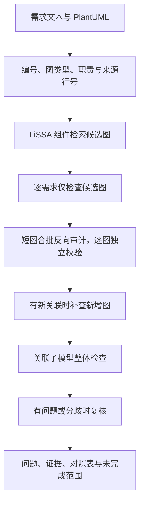

# 方法架构与文件对应

核心独立于 runtime，通过 `check(request, retriever, client, progress, cancelled)` 注入依赖。当前默认使用 candidate_first，full_context 保留为旧策略对照。主流程借鉴 MCeT，候选检索调用 LiSSA 部分组件，多图语义检查和证据校验由本项目实现。

每轮内部先将需求理解为检查点并声明适用维度，程序再按图职责过滤。此步骤不单开模型调用。用例图不承担时序与完整路径，职责外内容记为未核查。混合需求只对适用部分给出结论。检查点的语义拆分仍依赖模型。

| 步骤 | 模块与主要方法 |
|---|---|
| 启动 | cli.main() 组装输入、检索器、客户端与导出器 |
| 读取与统一格式 | inputs.load_request() 创建 contracts.Artifact 和 CheckRequest |
| 找候选 | retrieval.tokens()/tfidf()/LiSSARetriever.retrieve()，bridge/LissaBridge.java 调用原 LiSSA 组件 |
| 核心入口 | pipeline.check() 选择检查策略 |
| 调度 | scoped_pipeline.check_scoped()，内部 run_once()/run()/consume() 负责调用、有限纠正与校验 |
| 范围与关联 | scoping.select_models()/scope_groups()/model_batches()/recover_links() |
| 职责把关 | applicability.policy()/supports()/apply_policy()/all_outside() |
| 提示词 | prompts.SYSTEM、TASKS、SCOPE_CONTRACT、REVERSE_TASK，payload()/artifact_data() 组装材料 |
| 图理论 | prompt_profiles.PROFILES、SOURCES、CROSS_VIEW |
| 远程模型 | model_client.JSONModelClient.complete()，可选 HTTPEmbedder |
| 证据与复核 | issues.validate_issues()/checked_evidence()/reconcile_issues()，planning.compact_history() |
| 可选明确规则 | activity.check_before()，仅有限活动图语法，不等于自然语言自动验证 |
| 输出 | reporting.write_report()、issue_reporting、comparison |

逐需求细查只提供候选图。反向审计仍扫描所有图，但可以合批短图，各图不能互借证据。模型建议的新关联需要真实需求与图的引文才可补回，仍不是人工确认。相关组整体检查处理联合表达，另一张正确图不能抵消当前图已有的冲突或职责内缺失。

能解析但未通过局部结构校验的回答最多纠正一次，计入 max_calls。保留原尝试、有效问题和诊断，纠正成功才标记 resolved_by_call，未解决者仍输出 partial。不对失败调用编造业务遗漏。

当前读取完整图源码和行号，尚未完整结构化解析六类图，也不提供形式化正确性证明。检索收益、误报率、漏报率与成本需用受控实验评估。
