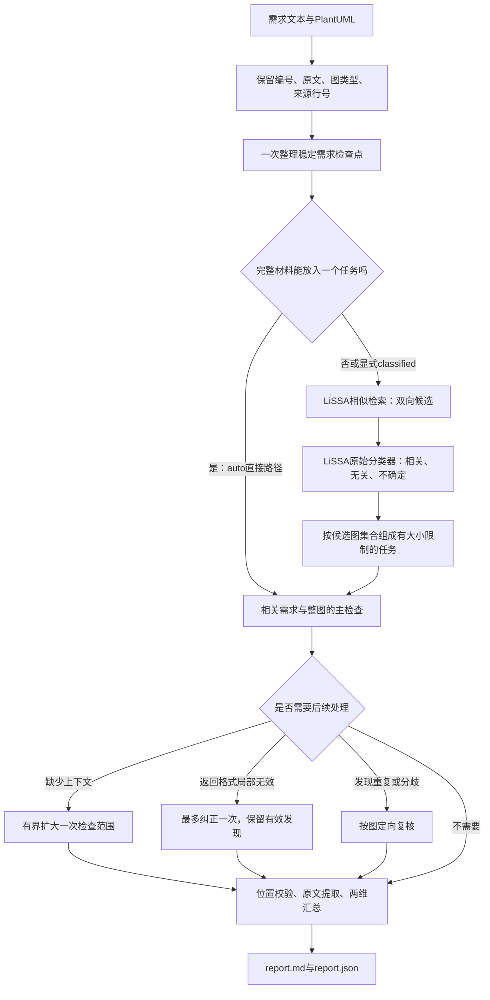

# 当前方法架构与源码对应

核心独立于runtime。入口是 `pipeline.check(request, retriever, client, progress, cancelled, relation_classifier, cache_dir)`。默认策略为task_based，旧candidate_first/full_context仅在显式选择时执行。

auto是基于单任务大小的保守调度规则，不是已经训练或证明最优的成本模型。默认单任务最多6条需求、30000个源字符；完整输入满足两项时跳过分类。较大输入走classified，或由用户显式指定classified/all做对照。任务最终序列化还有max_context_chars限制，超出时报告未完成，不截断图来冒充完整检查。

| 步骤 | 文件与方法 | 输入 → 输出 |
|---|---|---|
| 读取 | inputs.load_request()；contracts.Artifact/CheckRequest | txt/md/puml清单 → 带原文、ID和全局行号的材料 |
| 稳定检查点 | task_pipeline.check_tasks()准备阶段；task_data.prepare_checkpoints() | 原始需求 → 含完整前提、维度、来源的R.c1等检查点；不让每轮重新发明要求 |
| 活动路径辅助 | model_context.activity_context()；activity.parse_activity() | 从源码机械建立顺序/if-else控制流 → 从起点到结束的路径，保留分支前共同动作；不生成业务答案 |
| 调用计量 | stage_runner.StageRunner.run() | 提示词和材料 → 校验结果、用量、状态与缓存；失败不当作业务遗漏 |
| 自动路由 | task_pipeline.check_tasks()的compact判断 | 完整源材料大小 → all或classified；报告实际选择理由 |
| 初筛候选 | task_pipeline.candidate_pairs()；retrieval.LiSSARetriever.retrieve()；bridge/LissaBridge.java | 本地TF-IDF向量 → 原LiSSA CosineSimilarity排序候选；分数不是关联概率 |
| 真正关联分类 | relation_classifier.LiSSARelationClassifier.classify()；bridge/LissaClassifierBridge.java | 一条需求与一张图 → 原SimpleClassifier及本项目传输适配后的yes/no/uncertain与理由 |
| 组成任务 | task_data.plan_tasks() | 保留的关联 → 需求与候选整图；同候选集合才合批，不把传递相连的所有图拼成大包 |
| 主检查 | task_pipeline.check_tasks()中的run_task()/consume()；task_prompts.CHECK | 稳定检查点、完整图及图职责 → 检查点结论、定位问题、质量建议 |
| 职责与来源 | applicability.policy()/apply_policy()；task_data.hydrate_evidence()/parse_task_result()；issues.validate_issues() | 返回ID和行号 → 从原文提取quote、验证位置与职责，局部坏结果不删除有效邻项 |
| 补充上下文 | check_tasks()的expanded段 | 无关联或模型明确请求上下文 → 最多一次扩大；默认新增图超过8张则报告待复核 |
| 定向复核 | task_pipeline.resolve_findings()；task_prompts.RESOLVE | 同图重叠位置或重复检查点的问题 → 保留、排除、明确目标合并或不确定；不能无目标删问题 |
| 汇总输出 | reporting.write_report()；issue_reporting.issue_markdown() | 有效问题、范围与失败 → 默认两个结果文件 |
| 未来接runtime | contracts里的三个协议、progress和cancelled回调 | runtime负责材料和客户端适配，不改语义核心 |

## 提示词在哪里

task_prompts.SYSTEM是共同约束；PREPARE整理需求；RELATION只判断关联；CHECK执行主检查；RESOLVE按需解决重复和分歧。prompt_profiles.PROFILES提供通用图理论，由prompts.artifact_data()放入主检查的图材料。关联分类不携带课程准则，避免把风格建议当成业务关联。

主检查内部同时采用“逐项核对需求、沿模型路径看实际行为、多图联合表达”三个角度。它们是一次任务中的观察方法，不再固定对应三个追加调用。参考MCeT的检查思路，没有复用其代码，也没有照搬其投票和固定轮次，不能称为MCeT完整复现。

## LiSSA实际做了多少

本地TF-IDF由本项目生成；初筛真实调用原CosineSimilarity，默认每个方向候选上限20，不人为缩成一张图。随后真实调用原SimpleClassifier，其可配置模板通过本机回环网关进入本项目JSONModelClient。模板、关联判断提示词、模型服务选择、计量和uncertain保留是本项目适配。不是原论文整个RAG实验的复现；不声称继承论文准确率。

业务相反也应相关；no才排除，uncertain/分类失败保留。相似度候选和分类结果都保留，便于检查漏关联。检索没找到且触发补查的范围明确记录，不等于全项目已经扫完。auto直接路径会明确记录没有使用分类器，不伪造LiSSA的贡献。

## 结论和边界

覆盖与语义一致性独立。图职责外内容未核查，不报遗漏；明确行为与需求相反仍是冲突。质量建议不等于业务错误，用例名称本身不能决定对错。缺少上下文、格式失败、预算耗尽都不能写成确定遗漏。

当前仍以完整图源码为主要单位，未完成六类图的完整结构解析。检查点拆分、关联判断、路径语义和质量建议仍依赖模型；引用有效不证明语义正确。另一张正确图不抹掉错误图的明确冲突。

活动路径辅助仅支持顺序动作、完整if/else和终止；不支持循环、并发及完整PlantUML语法。默认最多32条路径、256个节点，不支持或超预算会写入model_structure并在主报告提示限制；原图仍完整提供。该辅助不自动把动作名转成业务规则，也不证明所有行为语义。

直接路径的candidate_links和classified_links为空，links只记录未经分类的输入范围；不能写成“全部关联”。evidence_links记录语义检查实际引用的需求检查点与图证据，允许多对多；check_scope记录提供范围，两者区分。可选建模建议返回格式错误时只拒绝该建议，不为它重复执行已经有效的业务检查，advisory_errors保留原因。

缓存只表示回答通过结构和来源校验，不表示人工确认。键包含材料内容、位置、实际提示词及模型配置；修改有效输入会让相应阶段失效。源文件变化仍可能让多个下游任务失效，不承诺最小增量计算。强制重新测语义请用-NoCache。

小材料逐对分类可能增加开销，因此auto支持直接检查。较大输入的筛选收益仍需要受控实验验证。
